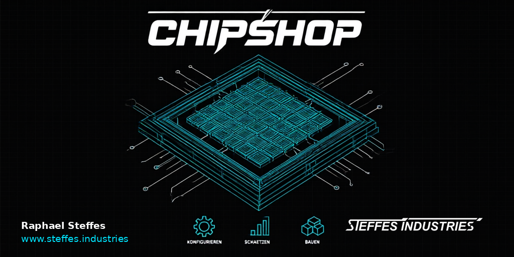
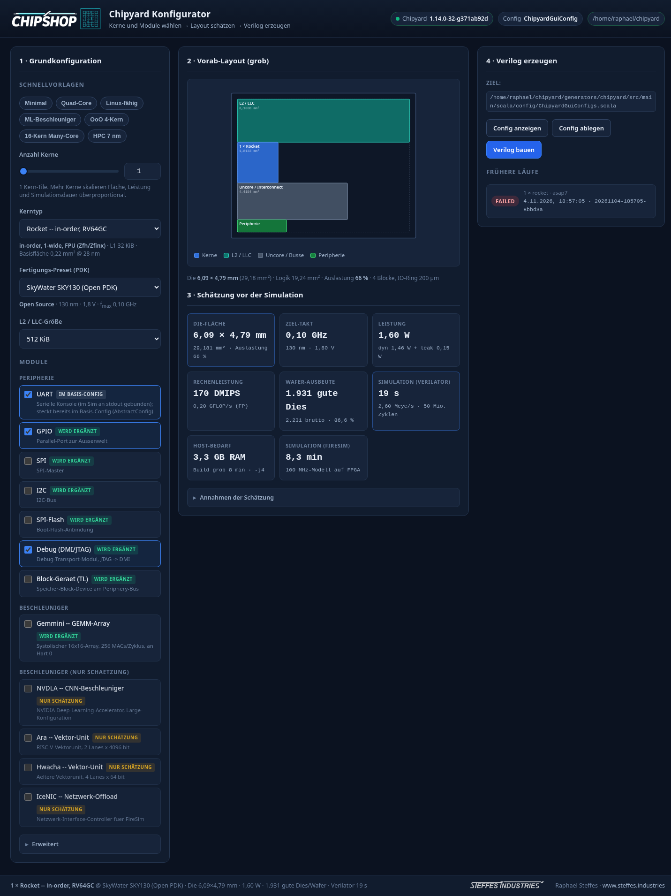

# ChipShop (Chipyard GUI)

<p align="center">
  
</p>

**Version 0.0.1** · MIT-Lizenz

Web-Oberfläche, um einen Chipyard-SoC einzustellen (Kerne, Module,
Fertigungs-Preset), sich **grob** Fläche / Leistung / Wafer-Ausbeute /
Simulationsaufwand schätzen zu lassen, ein **Vorab-Layout** zu sehen und
anschließend die **fertigen Verilog-Dateien** zu erzeugen und herunterzuladen.

Der Ablauf ist bewusst dreistufig: erst schätzen (Sekunden), dann bauen
(Minuten). Geschätzt wird, bevor teuer simuliert oder synthetisiert wird.

```
Kerne/Module/PDK wählen  ->  Layout + Kennzahlen  ->  make verilog + Download
     (Spalte 1)                 (Spalte 2)                (Spalte 3)
```

## Installation

```bash
git clone https://github.com/R-STEFFES/ChipShop.git
cd ChipShop
./start.sh
```

`start.sh` lädt die Chipyard-Umgebung (`env.sh`), legt bei Bedarf ein
Python-venv an, installiert `requirements.txt` und startet den Server auf
<http://localhost:5000>. Liegt das Chipyard-Checkout woanders, vorher
`export CHIPYARD_ROOT=/pfad/zu/chipyard` setzen (Standard
`/home/raphael/chipyard`).

Manuell:

```bash
cd ChipShop
source venv/bin/activate
pip install -r requirements.txt
python app.py            # PORT=5001 python app.py  -> anderer Port
```

Voraussetzungen: erfolgreich aufgesetztes Chipyard-Checkout
(`$CHIPYARD_ROOT`, Standard `/home/raphael/chipyard`) mit Conda-Umgebung,
`verilator` und `firtool`. Fehlt davon etwas, lädt die Oberfläche trotzdem
und rechnet weiter – nur der Verilog-Build ist dann gesperrt und die GUI sagt
das oben rechts an.

## Dateien

| Datei | Aufgabe |
| --- | --- |
| `app.py` | Flask-Backend, HTTP-Endpunkte, Build-Jobs in Hintergrund-Threads |
| `estimator.py` | reine Mathematik: Modulkatalog, Fläche, Leistung, Wafer, Simulation |
| `generator.py` | Scala-Config rendern/schreiben, `make verilog` ausführen, Verilog einsammeln |
| `templates/index.html` | Aufbau der Oberfläche (3 Spalten) |
| `static/js/app.js` | gesamte Frontend-Logik |
| `static/css/style.css` | Styling |
| `tests/test_estimator.py` | Tests für Schätzung und Config-Generierung |
| `assets/logo.png` | Logo (schwarz/weiß, Cyan-Motiv, 1024×1024) |
| `assets/hero.png` | Banner dieser README (1024×512) |
| `assets/screenshot.png` | Screenshot der Oberfläche für diese README |
| `assets/chipshop-wordmark.png` | ChipShop-Wortmarke, freigestellt |
| `assets/steffes-industries-black.png` | Steffes-Industries-Wortmarke, schwarz (heller Grund) |
| `assets/steffes-industries-white.png` | Steffes-Industries-Wortmarke, weiß (dunkler Grund) |
| `static/img/` | Logos der Oberfläche: Header-Lockup, Footer-Wortmarke, Favicon |
| `outputs/<job-id>/` | pro Build: `config.scala`, `spec.json`, `build.log`, `verilog/` |

## Oberfläche



**Spalte 1 – Grundkonfiguration.** Schnellvorlagen, Anzahl Kerne (Schieberegler
und Zahlfeld, synchron), Kerntyp (Rocket / BOOM small|medium|large),
Fertigungs-Preset (PDK), L2-/LLC-Größe, Modul-Checkboxen nach Kategorie.
Unter „Erweitert": RoCC-Demo-Beschleuniger, Aktivität, Simulationslänge in
Mio. Zyklen, Build-Parallelität.

Jedes Modul ist gekennzeichnet:

- **im Basis-Config** – steckt schon in `AbstractConfig` (z. B. UART);
  Abwählen entfernt es aktiv (`WithNoUART`).
- **wird ergänzt** – ein echtes Config-Fragment wird beim Bauen eingefügt.
- **nur Schätzung** – für dieses Modul gibt es in diesem Checkout kein
  fertiges Fragment. Es fließt in Fläche/Leistung ein, erscheint aber
  **nicht** im erzeugten Verilog. Die Oberfläche sagt das beim Generieren an.

**Spalte 2 – Vorab-Layout und Schätzung.** Grober Floorplan als SVG
(Shelf-Packing, Kern-Cluster als Kachelraster, IO-Ring), dazu Karten für
Die-Fläche, Zieltakt, Leistung, Rechenleistung, Beschleuniger, Wafer-Ausbeute,
Verilator- und FireSim-Simulationsdauer sowie Host-Bedarf. Alles rechnet bei
jeder Änderung nach (~200 ms Verzögerung). „Annahmen der Schätzung" listet
jede getroffene Annahme im Klartext auf.

**Spalte 3 – Verilog.** „Config anzeigen" zeigt die fertige Scala-Config,
„Config ablegen" schreibt sie ins Chipyard-Checkout, „Verilog bauen" startet
den Build und zeigt Status, Phase, Dauer und den Log-Ausschnitt live. Am Ende
gibt es die Dateiliste (anklickbar) und ein ZIP. Darunter die früheren Läufe,
anklickbar zum Nachsehen. `Strg`/`Cmd` + `Enter` startet den Build.

## API

| Methode | Pfad | Zweck |
| --- | --- | --- |
| GET | `/api/catalog` | PDK-Presets, Kerntypen, Module, L2-Größen, Standardwerte, Chipyard-Info |
| POST | `/api/estimate` | Schätzung + Config-Vorschau |
| POST | `/api/config` | Scala-Config rendern (`?write=1` legt sie ab) |
| POST | `/api/build` | Build starten (Hintergrund), liefert `job.id` |
| GET | `/api/build/<id>` | Status, Phase, Log-Ausschnitt (`log_tail`) |
| GET | `/api/build/<id>/files` | Dateiliste der erzeugten RTL |
| GET | `/api/build/<id>/file/<pfad>` | einzelne Datei ansehen |
| GET | `/api/build/<id>/zip` | alle Dateien + `config.scala` als ZIP |
| GET | `/api/jobs` | frühere Läufe |

## Verilog-Ausgabe

Die RTL landet bei `make verilog` in

```
<CHIPYARD_ROOT>/sims/verilator/generated-src/chipyard.harness.TestHarness.<CONFIG>/gen-collateral/
```

und wird von dort nach `outputs/<job-id>/verilog/` kopiert – zusammen mit den
Dateilisten und Speicher-Konfigurationen aus der Build-Ebene. Nur die oberste
Ebene des Build-Verzeichnisses einzusammeln würde die `.sv`-Dateien
verpassen; `generator.collect_verilog()` nimmt deshalb beides mit. Für einen
1-Kern-Rocket entstehen so rund 480 RTL-Dateien (~17 MiB). Das ZIP enthält
den kompletten Ordner plus `config.scala` und `spec.json`.

Der generierte `ChipyardGuiConfig` wird nach
`generators/chipyard/src/main/scala/config/ChipyardGuiConfigs.scala`
geschrieben – **das ist eine Änderung im Chipyard-Checkout**, die beim
nächsten Generieren überschrieben wird.

## Schätzmodell

Zahlen sind bewusst **Größenordnungen**, keine Vorhersagen. Kalibrierung:

- Alle Flächenwerte sind auf **28 nm** bezogen und werden mit
  `(nm/28)^1.3` skaliert (1.3 statt 2.0, weil SRAM und Verdrahtung langsamer
  schrumpfen als Logik). 130 nm ergibt dadurch ~7.4×, 7 nm ~0.16× der Fläche.
- 30 % Zuschlag für Verdrahtung, Taktbäume und Whitespace.
- Takt = min(Kern-Grenzfrequenz, Prozess-Grenzfrequenz) – konservative Seite.
- Leistung = Leistungsdichte × Die-Fläche × f/f_max × Aktivität, plus Leckstrom.
- Yield nach Murphy, Wafer 300 mm, Sägegasse 80 µm.
- Verilator ~2.6 Mcycles/s für einen Rocket-Kern; weitere und schwerere Kerne
  senken den Durchsatz.

Alle aktuell geltenden Annahmen stehen zur Laufzeit in `assumptions` der
Schätzantwort (und im UI aufklappbar), damit die Zahlen nicht ohne Kontext
dastehen.

## Module ändern

Katalog in `estimator.py` → `MODULES`. Felder:

- `fragment`: Scala-Fragment, das beim Auswählen eingefügt wird.
- `available: False`: kein nutzbares Fragment in diesem Checkout → nur
  Schätzung, Warnung im UI.
- `in_base: True`: steckt schon im Basis-Config (`AbstractConfig`).
  **Nicht** erneut als Fragment einfügen – sonst entsteht das Gerät ein
  zweites Mal und der Build bricht mit
  `Ports cannot overlap: AddressSet(...)` ab. `remove_fragment` gibt an, was
  beim Abwählen entfernt wird (z. B. `chipyard.config.WithNoUART`).

`tests/test_estimator.py` prüft beides automatisch: dass kein Basis-Modul
doppelt eingefügt wird und dass jedes Fragment im Katalog als Scala-Klasse im
Checkout existiert.

Ein neues PDK oder einen Kerntyp ergänzt man in `PRESETS` bzw. `CORE_TYPES`
(gleiche Datei); die Oberfläche holt sich die Auswahl über `/api/catalog`.

## Tests

```bash
cd ChipShop
venv/bin/python -m unittest discover -s tests -v
```

## Grenzen

- **Kein Tapeout-Werkzeug.** Die GUI erzeugt RTL und Schätzungen; Synthese,
  Place & Route und DRC macht man anschließend (z. B. LibreLane/OpenLane).
- Die Schätzung modelliert nur einen Die, keine Bumps, Packaging, Gehäuse
  oder Testlogik.
- Der Build braucht die Chipyard-Conda-Umgebung inkl. `firtool`; der erste
  Build kompiliert Scala und dauert entsprechend lange. Wenn etwas fehlt,
  sagt das Backend, was es erwartet.

## Steffes Industries

<picture>
  <source media="(prefers-color-scheme: dark)" srcset="assets/steffes-industries-white.png">
  
</picture>

ChipShop entsteht bei **Steffes Industries** – Raphael Steffes.
Website: <https://www.steffes.industries>

Die Oberfläche trägt die Marke ebenfalls: das ChipShop-Logo sitzt im Header,
die Steffes-Industries-Wortmarke mit Verweis auf die Website im Footer.

## Lizenz

MIT – siehe [LICENSE](LICENSE). Änderungen stehen in [CHANGELOG.md](CHANGELOG.md).
