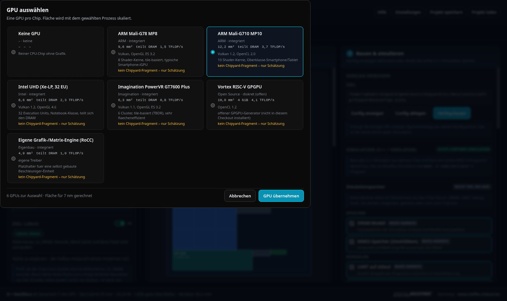
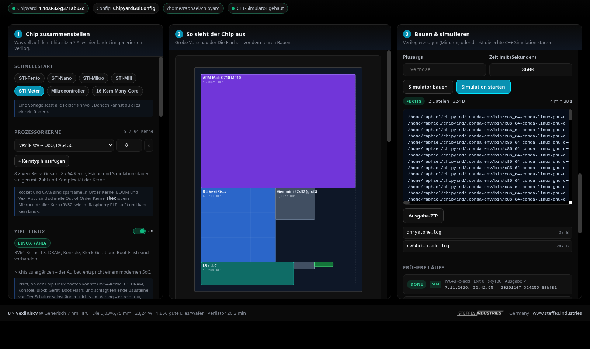
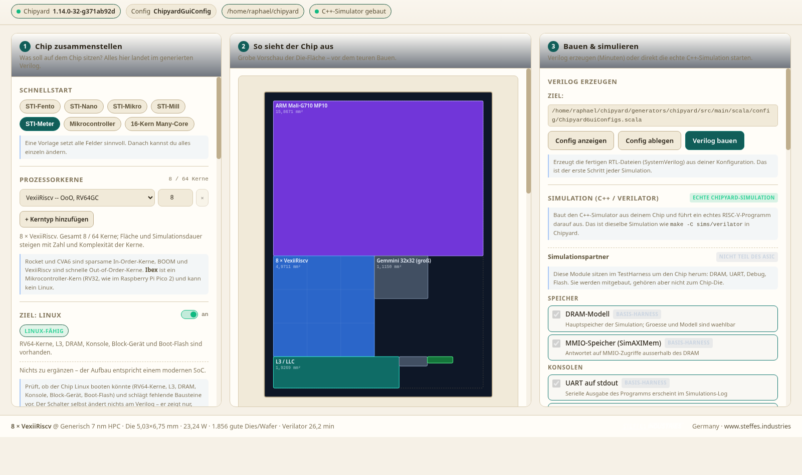

# ChipShop (Chipyard GUI)

<p align="center">
  
</p>

**Version 0.1.0** · MIT-Lizenz

Web-Oberfläche, um einen Chipyard-SoC einzustellen (Kerne, L3-Cache, GPU,
Module, Fertigungs-Preset), sich **grob** Fläche / Leistung / Wafer-Ausbeute /
Simulationsaufwand schätzen zu lassen, ein **Vorab-Layout** zu sehen,
anschließend die **fertigen Verilog-Dateien** zu erzeugen und die **echte
C++-Simulation aus Chipyard** mit einem RISC-V-Programm laufen zu lassen.

Der Ablauf ist bewusst dreistufig: erst zusammenstellen und schätzen
(Sekunden), dann bauen (Minuten), dann simulieren.

```
Kerne/L3/GPU/PDK/Module  ->  Layout + Kennzahlen  ->  make verilog
        (Spalte 1)              (Spalte 2)         ->  C++-Simulation
                                                       (Spalte 3)
```

## Installation

```bash
git clone https://github.com/R-STEFFES/ChipShop.git
cd ChipShop
./start.sh
```

`start.sh` lädt die Chipyard-Umgebung (`env.sh`), legt bei Bedarf ein
Python-venv an, installiert `requirements.txt` und startet den Server auf
<http://localhost:5000>. Liegt das Chipyard-Checkout woanders, vorher
`export CHIPYARD_ROOT=/pfad/zu/chipyard` setzen (Standard
`/home/raphael/chipyard`).

Manuell:

```bash
cd ChipShop
source venv/bin/activate
pip install -r requirements.txt
python app.py            # PORT=5001 python app.py  -> anderer Port
```

Voraussetzungen: erfolgreich aufgesetztes Chipyard-Checkout
(`$CHIPYARD_ROOT`, Standard `/home/raphael/chipyard`) mit Conda-Umgebung,
`verilator` und `firtool`. Fehlt davon etwas, lädt die Oberfläche trotzdem
und rechnet weiter – nur der Verilog-Build ist dann gesperrt und die GUI sagt
das oben rechts an.

## Dateien

| Datei | Aufgabe |
| --- | --- |
| `app.py` | Flask-Backend, HTTP-Endpunkte, Build-Jobs in Hintergrund-Threads |
| `estimator.py` | reine Mathematik: Modulkatalog, Fläche, Leistung, Wafer, Simulation |
| `generator.py` | Scala-Config rendern/schreiben, `make verilog` ausführen, Verilog einsammeln |
| `templates/index.html` | Aufbau der Oberfläche (3 Spalten) |
| `static/js/app.js` | gesamte Frontend-Logik |
| `static/css/style.css` | Styling |
| `tests/` | Tests für Schätzung, Config-Generierung, API und Build-Diagnosen |
| `assets/logo.png` | Logo (schwarz/weiß, Cyan-Motiv, 1024×1024) |
| `assets/hero.png` | Banner dieser README (1024×512) |
| `assets/screenshot.png` | Hauptansicht im Marken-Theme (1600×950), Vorlage STI-Meter |
| `assets/screenshot-gpu.png` | Auswahlfenster der GPUs |
| `assets/screenshot-simulation.png` | Simulationsbereich mit Log und Ausgabe |
| `assets/screenshot-hell.png` | Dieselbe Oberfläche im hellen Theme „Papier“ |
| `assets/chipshop-wordmark.png` | ChipShop-Wortmarke, freigestellt |
| `assets/steffes-industries-black.png` | Steffes-Industries-Logo, schwarz (heller Grund) |
| `assets/steffes-industries-white.png` | Steffes-Industries-Logo, weiß (dunkler Grund) |
| `static/img/` | Logos der Oberfläche: Header-Lockup, Footer-Logo, Favicon |
| `outputs/<job-id>/` | pro Build: `config.scala`, `spec.json`, `build.log`, `verilog/` |

## Oberfläche

<p align="center">
  
</p>

*Hauptansicht im Marken-Theme (Schwarz + Cyan) mit der Vorlage **STI-Meter**:
acht VexiiRiscv-Kerne, 4 MiB L3 mit vier Banks, Gemmini 32×32 als NPU,
Mali-G710 als GPU, 8 GiB DRAM – unten links das grüne „Linux-fähig“.*

<p align="center">
  
  
</p>

*Links: das GPU-Auswahlfenster mit sechs Karten, Fläche für den gewählten
Prozessknoten und dem ehrlichen Hinweis „kein Chipyard-Fragment – nur
Schätzung“. Rechts: der Simulationsbereich mit gebautem C++-Simulator,
Lauf, Log, Ausgabe-ZIP und Historie.*

<p align="center">
  
</p>

*Dieselbe Oberfläche im hellen Theme „Papier“ – zehn Farbschemata stehen zur
Wahl.*

**Bildmaterial für Marketing** (Post, Präsentation, Datenblatt) liegt
zusätzlich außerhalb des Projekts unter
`~/Schreibtisch/STI-Marketing/chipshop/screenshots/` – mit einer
`README.md`, die jede Aufnahme beschreibt und die Farbwerte nennt.

Das Fenster ist **gesperrt**: Kopf und Fuß bleiben stehen, die Seite selbst
scrollt nie. Jede der drei Spalten hat einen eigenen Scrollbalken
(`.col-head` fest, `.col-body` scrollt). Auf schmalen Bildschirmen
(< 820 px) wird daraus ein normal scrollendes Stapellayout.

**Spalte 1 – Chip zusammenstellen.** Fünf **STI-Vorlagen** (Fento bis Meter),
gemischte Kerntypen mit separaten Stückzahlen (bis zu 64 Kerne), Fertigungs-
Preset (PDK), **L3-Cache** (an/aus, Größe 128 KiB–4 MiB, Assoziativität,
Banks), **GPU-Auswahl** über ein eigenes Fenster, **NPU** mit Größenwahl und
Modul-Checkboxen nach Kategorie. Dazu ein **Linux-Ziel**: der Schalter prüft
laufend, ob der Aufbau Linux booten könnte, und schlägt fehlende Bausteine
mit einem Klick zum Ergänzen vor. Projekte lassen sich als JSON speichern und
laden; in den Einstellungen stehen **zehn Farbschemata** (Dunkel,
Schwarz·Cyan (Marke), Dunkel·Cyan, Mitternacht, Carbon, Matrix, Amber, Hell,
Tageslicht, Papier), die im Browser gespeichert bleiben.

### Prozessorkerne

| Kern | ISA | Charakter | Linux |
| --- | --- | --- | --- |
| **Rocket** | RV64GC | in-order, klein, robust (Standard) | ja |
| **BOOM Small/Medium/Large** | RV64GC | out-of-order, 2–4-wide decode | ja |
| **CVA6** | RV64GC | 6-stufig, Anwendungskern (ex-Ariane) | ja |
| **VexiiRiscv** | RV64GC | moderner OoO-Kern, hohe Taktrate | ja |
| **Ibex** | RV32IMC | Mikrocontroller (Pico-2-Klasse, kein MMU) | nein |

Ibex wird mit `ibex.WithNIbexCores(n)` und dem nötigen
`WithInclusiveCacheWriteBytes(4)` geschrieben, die anderen mit ihren
`WithN…Cores(n)`-Fragmenten. RV32- und RV64-Kerne zu mischen ergibt keinen
sinnvollen Chip – die Oberfläche warnt davor.

### NPU (KI-Beschleuniger)

| Auswahl | Fragment | MACs/Zyklus |
| --- | --- | --- |
| Gemmini 16×16 | `gemmini.DefaultGemminiConfig` | 256 |
| Gemmini 16×16 WS | `…(gemmini.GemminiConfigs.chipConfig)` | 256 |
| Gemmini 32×32 | `…(gemmini.GemminiConfigs.largeChipConfig)` | 1024 |
| NVDLA small | `nvidia.blocks.dla.WithNVDLA("small")` | 512 |
| NVDLA large | `nvidia.blocks.dla.WithNVDLA("large", true)` | 1024 |

Alle fünf sind echte Chipyard-Fragmente: sie landen im Verilog, im Floorplan
(eigener Block), in Fläche/Leistung/TOPS und im Simulations-Build. Die NPU
schaltet automatisch den 128-Bit-Systembus ein (BuildRoCC). NVDLA zieht die
NVDLA-Hardware mit in den Verilator-Build und braucht dadurch deutlich länger.

### STI-Vorlagen

| Vorlage | Kerne | Fertigung | L3 | DRAM | Extras |
| --- | --- | --- | --- | --- | --- |
| **STI-Fento** | 1× Rocket | SKY130 (130 nm) | 256 KiB | 256 MiB | minimaler Linux-Chip |
| **STI-Nano** | 2× Rocket | Nangate 45 nm | 512 KiB | 512 MiB | Linux, SPI/I2C |
| **STI-Mikro** | 4× Rocket | TSMC 28 nm | 1 MiB, 2 Banks | 1 GiB | Gemmini 16×16 |
| **STI-Mill** | 4× BOOM Medium | TSMC 28 nm | 2 MiB, 2 Banks | 2 GiB | Gemmini 32×32, PowerVR-GPU |
| **STI-Meter** | 8× VexiiRiscv | 7 nm HPC | 4 MiB, 4 Banks | 8 GiB | Gemmini 32×32, Mali-G710 |

Dazu die Sonderfälle „Mikrocontroller“ (Ibex, RV32, kein Linux) und
„16-Kern Many-Core“.

### Linux-Ziel und Empfehlungen

Der Schalter „Ziel: Linux“ ändert nichts am Verilog – er ist ein Prüfer. Er
meldet konkret, was fehlt: RV32-Kerne ohne MMU, fehlender L3, zu wenig DRAM
(< 256 MiB), fehlende Konsole (UART), Block-Gerät oder Boot-Flash. Darunter
stehen **empfohlene Zusatzbausteine für einen modernen Prozessor** (L3 ≥ 1 MiB,
2 Banks ab vier Kernen, ≥ 1 GiB DRAM, Debug, Boot-Flash, Speicher-Controller,
NPU, GPU) – mit Knopf „Fehlendes ergänzen“, der alles in einem Schritt setzt.


Jedes Modul ist gekennzeichnet:

- **im Basis-Config** – steckt schon in `AbstractConfig` (z. B. UART);
  Abwählen entfernt es aktiv (`WithNoUART`).
- **wird ergänzt** – ein echtes Config-Fragment wird beim Bauen eingefügt.
- **nur Schätzung** – für dieses Modul gibt es in diesem Checkout kein
  fertiges Fragment. Es fließt in Fläche/Leistung ein, erscheint aber
  **nicht** im erzeugten Verilog. Die Oberfläche sagt das beim Generieren an.

**L3-Cache.** Chipyards `InclusiveCache` ist die gemeinsame, inklusive
Last-Level-Cache-Ebene oberhalb der Kern-L1 – deshalb heißt sie hier L3/LLC.
Eingeschaltet wird `WithInclusiveCache(nWays, capacityKB)` plus optional
`WithNBanks(n)` geschrieben, ausgeschaltet `WithBroadcastManager` (nur
Kohärenz-Hub, deutlich weniger Fläche).

**GPU.** Das Auswahlfenster zeigt sechs GPUs (Mali-G78 MP8, Mali-G710 MP10,
Intel Xe-LP, PowerVR GT7600 Plus, Vortex, eigene RoCC-Engine) mit Fläche für
den aktuell gewählten Prozessknoten, Speicher, API und Leistung. Die GPU wird
als eigener Block in den Floorplan gepackt und zählt zu Fläche, Leistung und
Rechenleistung. **Ehrlich:** es gibt in diesem Chipyard-Checkout keinen
GPU-Generator, also kein Config-Fragment – die GPU landet nicht im Verilog.
Die Oberfläche markiert das an jeder Stelle.

**Spalte 2 – Vorabvorschau.** Der Floorplan nutzt die mittlere Spalte großflächig
und zeigt Kerngruppen getrennt. Das Shelf-Packing probiert mehrere Breiten und
wählt die kompakte Die-Belegung mit IO-Ring. Darunter eine
Klartext-Zusammenfassung („Die-Fläche 28,5 mm² – etwa ein Fingernagel“) und
die Kennzahlen: Die-Fläche, Zieltakt, Leistung, Rechenleistung, GPU-Leistung,
Wafer-Ausbeute sowie geschätzte Verilator- und FireSim-Laufzeit samt
Host-Bedarf. Bei erwarteter RAM-Überschreitung wird vor dem Build gewarnt.

**Spalte 3 – Bauen und simulieren.** „Config anzeigen“ zeigt die fertige
Scala-Config, „Config ablegen“ schreibt sie ins Chipyard-Checkout, „Verilog
bauen“ startet `make verilog` und zeigt Status, Phase, Dauer und Log live. Bei
Fehlern erscheinen Ursache, erkannte Fundstelle und ein konkreter nächster
Prüfschritt. Darunter der Simulationsbereich (siehe unten) und die früheren
Läufe. `Strg`/`Cmd` + `Enter` startet den Verilog-Build.

## Simulation (echte Chipyard-Simulation)

Der Simulationsbereich in Spalte 3 macht dasselbe wie die Chipyard-Kommandozeile,
nur mit Klicks:

1. **Simulationspartner wählen.** Diese Module sitzen im `TestHarness` um den
   Chip herum und sind *nicht* Teil des ASIC:

   | Partner | Config-Fragment | Bedeutung |
   | --- | --- | --- |
   | DRAM-Modell | `WithBlackBoxSimMem(additionalLatency)` oder `WithSimAXIMem` | SimDRAM mit echtem Timing (langsam) oder 1-Zyklus-Speicher (schnell) |
   | DRAM-Größe | `WithExtMemSize(BigInt …)` | Adressraum des SoC (64 MiB – 8 GiB) |
   | MMIO-Speicher | `WithSimAXIMMIO` | Antwortet auf MMIO-Zugriffe |
   | UART auf stdout | `WithUARTAdapter` | Programmausgabe im Log |
   | SerialTL/TSI | `WithSimTSIOverSerialTL` | Programm laden, Host-Anbindung |
   | SimJTAG / SimDMI | `WithSimJTAGDebug`, `WithSimDMI` | Debug wie am Board |
   | SPI-Flash-Modell | `WithSimSPIFlashModel(rdOnly)` | Boot-Flash |
   | Block-Device | `WithSimBlockDevice` | Festplatte; braucht SoC-Modul „Block-Gerät“ |
   | NIC-Loopback | `WithLoopbackNIC` | Netzwerkpakete zurück zum Absender |

   Partner, die schon in `AbstractConfig` stecken, sind in der Oberfläche als
   „Basis-Harness“ markiert (abwählen geht dort nicht, Chipyard kennt kein
   Entfernen-Fragment). Ergänzbare Partner werden als echtes
   `chipyard.harness.*`-Fragment geschrieben und haben Vorrang vor den
   Basis-Bindern (in Chipyard gewinnt das links stehende Fragment).

2. **Programm wählen.** Die Liste kommt aus dem Checkout
   (`.conda-env/…/riscv-tests/benchmarks/*.riscv`, `isa/*.riscv`,
   `generators/riscv-sodor/riscv-bmarks/*.riscv`, `tests/build/*.riscv`,
   `outputs/workloads/*.riscv`). Eigene Programme lassen sich als Pfad
   eintragen. Plusargs (z. B. `+verbose`) und ein Zeitlimit sind einstellbar.

3. **„Simulator bauen“** ruft `make -C sims/verilator CONFIG=ChipyardGuiConfig
   -jN` auf (RTL + C++-Simulator). **„Simulation starten“** baut bei Bedarf
   zuerst und führt dann
   `make CONFIG=… run-binary-fast BINARY=<programm>` aus – also den echten
   Verilator-Simulator mit dem gewählten RISC-V-Binary. Log, Phase, Dauer,
   Exit-Code und die Dateien aus `sims/verilator/output/<long_name>/` landen im
   Job-Verzeichnis unter `outputs/<job-id>/sim-output/` und sind als ZIP
   herunterladbar.

Ein Simulationslauf schreibt – wie jeder Build – den `ChipyardGuiConfig` ins
Checkout. Zwei Läufe gleichzeitig teilen sich dieses Checkout und sollten
vermieden werden. Ändert sich nur der Kommentarkopf (z. B. eine andere GPU
oder ein anderer Partner in der Beschreibung), schreibt ChipShop die Datei
**nicht** neu – sonst würde Chipyard jedes Mal RTL und Simulator neu bauen.
Ein zweiter Lauf mit derselben Konfiguration dauert dadurch Sekunden statt
Minuten.

## API

| Methode | Pfad | Zweck |
| --- | --- | --- |
| GET | `/api/catalog` | PDK-Presets, Kerntypen, Module, GPUs, Simulationspartner, L3-/DRAM-Auswahlen, Standardwerte, Chipyard-Info |
| GET | `/api/workloads` | fertige RISC-V-Programme im Checkout |
| POST | `/api/estimate` | Schätzung + Config-Vorschau |
| POST | `/api/config` | Scala-Config rendern (`?write=1` legt sie ab) |
| POST | `/api/build` | Verilog-Build starten (Hintergrund), liefert `job.id` |
| POST | `/api/simulate` | C++-Simulator bauen (`run:false`) oder bauen+starten (`run:true`, `workload`, `sim_flags`, `timeout_s`) |
| GET | `/api/build/<id>` | Status, Phase, Log-Ausschnitt (`log_tail`) – für Build- und Sim-Jobs |
| GET | `/api/build/<id>/files` | Dateiliste (RTL bzw. Simulations-Ausgabe) |
| GET | `/api/build/<id>/file/<pfad>` | einzelne Datei ansehen |
| GET | `/api/build/<id>/zip` | alle Dateien + `config.scala` als ZIP |
| GET | `/api/jobs` | frühere Läufe (mit `kind: verilog|sim`) |

## Verilog-Ausgabe

Die RTL landet bei `make verilog` in

```
<CHIPYARD_ROOT>/sims/verilator/generated-src/chipyard.harness.TestHarness.<CONFIG>/gen-collateral/
```

und wird von dort nach `outputs/<job-id>/verilog/` kopiert – zusammen mit den
Dateilisten und Speicher-Konfigurationen aus der Build-Ebene. Nur die oberste
Ebene des Build-Verzeichnisses einzusammeln würde die `.sv`-Dateien
verpassen; `generator.collect_verilog()` nimmt deshalb beides mit. Für einen
1-Kern-Rocket entstehen so rund 480 RTL-Dateien (~17 MiB). Das ZIP enthält
den kompletten Ordner plus `config.scala` und `spec.json`.

Der generierte `ChipyardGuiConfig` wird nach
`generators/chipyard/src/main/scala/config/ChipyardGuiConfigs.scala`
geschrieben – **das ist eine Änderung im Chipyard-Checkout**, die beim
nächsten Generieren überschrieben wird.

## Schätzmodell

Zahlen sind bewusst **Größenordnungen**, keine Vorhersagen. Kalibrierung:

- Alle Flächenwerte sind auf **28 nm** bezogen und werden mit
  `(nm/28)^1.3` skaliert (1.3 statt 2.0, weil SRAM und Verdrahtung langsamer
  schrumpfen als Logik). 130 nm ergibt dadurch ~7.4×, 7 nm ~0.16× der Fläche.
- 30 % Zuschlag für Verdrahtung, Taktbäume und Whitespace.
- Takt = min(Kern-Grenzfrequenz, Prozess-Grenzfrequenz) – konservative Seite.
- Leistung = Leistungsdichte × Die-Fläche × f/f_max × Aktivität, plus Leckstrom.
- Yield nach Murphy, Wafer 300 mm, Sägegasse 80 µm.
- Verilator ~2.6 Mcycles/s für einen Rocket-Kern; weitere und schwerere Kerne
  senken den Durchsatz.

Alle aktuell geltenden Annahmen stehen zur Laufzeit in `assumptions` der
Schätzantwort (und im UI aufklappbar), damit die Zahlen nicht ohne Kontext
dastehen.

## Module ändern

Katalog in `estimator.py` → `MODULES`. Felder:

- `fragment`: Scala-Fragment, das beim Auswählen eingefügt wird.
- `available: False`: kein nutzbares Fragment in diesem Checkout → nur
  Schätzung, Warnung im UI.
- `in_base: True`: steckt schon im Basis-Config (`AbstractConfig`).
  **Nicht** erneut als Fragment einfügen – sonst entsteht das Gerät ein
  zweites Mal und der Build bricht mit
  `Ports cannot overlap: AddressSet(...)` ab. `remove_fragment` gibt an, was
  beim Abwählen entfernt wird (z. B. `chipyard.config.WithNoUART`).

Dieselbe Datei enthält drei weitere Kataloge:

- `GPUS` – Grafikeinheiten mit `area28`, `flops_per_cycle`, `fmax_ghz`,
  `vram_gib`, `shared_memory` und optional `fragment`. Ohne `fragment` gilt
  die GPU nur für die Schätzung (Warnung im UI).
- `SIM_PARTNERS` – Harness-Module der Simulation. `in_base: True` heißt
  „steckt in `AbstractConfig`“, `requires` nennt nötige SoC-Module
  (z. B. `blockdev` für das Block-Device-Modell).
- `DRAM_MODELS` – SimDRAM gegen SimAXIMem; das gewählte Modell bestimmt
  Durchsatz- und RAM-Schätzung.

Ein neues PDK oder einen Kerntyp ergänzt man in `PRESETS` bzw. `CORE_TYPES`
(gleiche Datei); die Oberfläche holt sich die Auswahl über `/api/catalog`.
`tests/test_estimator.py` prüft automatisch, dass jedes Fragment
(Module **und** Simulationspartner) als Scala-Klasse im Checkout existiert.

## Tests

```bash
cd ChipShop
venv/bin/python -m unittest discover -s tests -v
```

## Grenzen

- **Kein Tapeout-Werkzeug.** Die GUI erzeugt RTL, Schätzungen und startet die
  Verilator-Simulation; Synthese, Place & Route, DRC oder Tapeout führt sie
  nicht aus.
- **GPU ohne Fragment.** In diesem Checkout gibt es keinen GPU-Generator
  (Vortex ist nicht installiert). Die GPU-Auswahl ist deshalb eine
  Flächen-/Leistungsrechnung mit klarer Kennzeichnung; sie erscheint nicht im
  Verilog. Wer einen Generator ergänzt, trägt ihn in `estimator.GPUS` mit
  `fragment` ein – dann wird er wie jedes andere Modul geschrieben.
- **Neue Kerne sind nicht alle durchgebaut.** Ibex (RV32) ist ein
  Mikrocontroller ohne MMU und braucht eigene Bare-Metal-Programme; CVA6 und
  VexiiRiscv sind Fremdgeneratoren, deren Build in diesem Checkout nicht
  geprüft wurde. Rocket/BOOM sind die erprobten Pfade. Gemmini baut wie
  bisher, NVDLA zieht die NVDLA-Hardware mit und braucht deutlich länger –
  NVDLA regeneriert sein vorverarbeitetes RTL bei jedem `make`-Lauf, der
  Verilator-Build läuft dort also jedes Mal erneut (gemessen: ~6 min pro Lauf).
- **NVDLA ist gebaut, aber nicht durchsimuliert.** Die NVDLA-Fragmente
  elaborieren und der Verilator-Build läuft durch; der Beispiel-ISA-Test
  `rv64ui-p-add` lief mit NVDLA im Design jedoch in ein Zykluslimit, weil
  NVDLA eigene Workloads/Setup braucht. Für Simulationen ist Gemmini der
  erprobte Weg; NVDLA ist als Bau-/Flächenoption gedacht.
- **Simulationspartner mit Basis-Bindung.** `UART`, `SimJTAG`, `SimDMI`,
  `SerialTL`, `MMIO` und das SPI-Flash-Modell stecken in `AbstractConfig`.
  Chipyard hat für Harness-Binder kein „Entfernen“-Fragment; die Oberfläche
  markiert sie darum als Basis und erlaubt nur Parameter-Overrides
  (z. B. beschreibbares Flash).
- Kerntypen, Module, GPUs und Simulationspartner werden über den geprüften
  Katalog in `estimator.py` gepflegt; ein Import beliebiger GitHub-Repositories
  ist nicht implementiert.
- Die Schätzung modelliert nur einen Die, keine Bumps, Packaging, Gehäuse
  oder Testlogik.
- Der Build braucht die Chipyard-Conda-Umgebung inkl. `firtool` und
  `verilator`; der erste Build kompiliert Scala und dauert entsprechend lange
  (1-Kern-Rocket: grob 10–20 Minuten auf diesem Rechner). Wenn etwas fehlt,
  sagt das Backend, was es erwartet.
- Zwei Jobs gleichzeitig schreiben dieselbe `ChipyardGuiConfigs.scala` im
  Checkout – bitte nacheinander laufen lassen.

## Steffes Industries

<picture>
  <source media="(prefers-color-scheme: dark)" srcset="assets/steffes-industries-white.png">
  
</picture>

ChipShop entsteht bei **Steffes Industries** – Raphael Steffes.
Website: <https://www.steffes.industries>

Die Oberfläche trägt die Marke ebenfalls: das ChipShop-Logo sitzt im Header,
das Steffes-Industries-Logo mit Verweis auf die Website im Footer. Beide
Logodateien sind aus dem offiziellen `google_STI_logo.png` (PR/Logo)
zugeschnitten – die weiße Fassung entsteht aus dessen Alphakanal.

## Lizenz

MIT – siehe [LICENSE](LICENSE). Änderungen stehen in [CHANGELOG.md](CHANGELOG.md).
